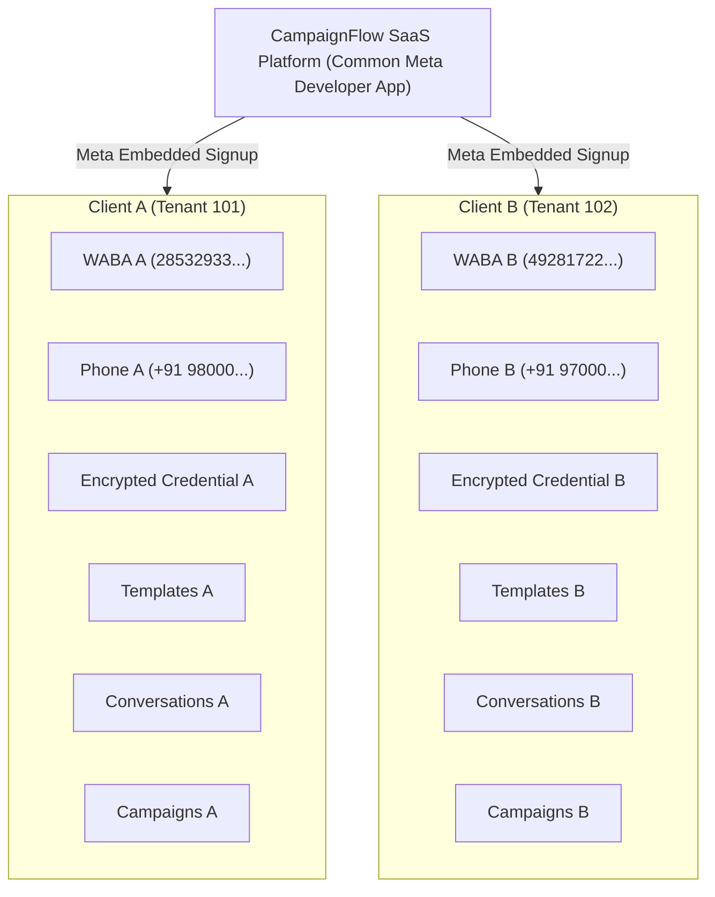

# Multi-Tenant WhatsApp SaaS Architecture: Independent Client WABAs with Common Platform Meta App

## 1. Executive Summary & Core Architectural Decision

This SaaS platform is architected around the official Meta Tech Provider Embedded Signup model:

- **ONE Common Meta Developer App**: Owned and managed exclusively by the SaaS platform (`META_APP_ID`, `META_APP_SECRET`, `META_EMBEDDED_SIGNUP_CONFIG_ID`). Customers **never** need to create their own Meta Developer Apps.
- **ONE Common Embedded Signup Integration**: Single Facebook Login for Business dialog embedded inside the SaaS Settings UI.
- **MULTIPLE Independent Client Meta Business Portfolios**: Each client business connects their official Meta Business Portfolio.
- **MULTIPLE Independent WhatsApp Business Accounts (WABAs)**: Each client owns their distinct WABA.
- **SEPARATE WhatsApp Phone Numbers**: Each client registers and verifies their official phone number(s).
- **STRICT Tenant-Level Credential Isolation**: Every outbound message and template submission is signed using the authorized client's AES-256-GCM encrypted token.
- **ONE Centralized Webhook Endpoint**: Incoming webhook payloads are dynamically routed to the originating tenant using `phone_number_id` and WABA `entry.id`.



---

## 2. Meta Tech Provider & Embedded Signup Requirements

### Platform-Level Credentials (.env)
```ini
# Platform Meta Developer App (Owned by SaaS Platform)
META_APP_ID=your_meta_app_id
META_APP_SECRET=your_meta_app_secret
META_EMBEDDED_SIGNUP_CONFIG_ID=your_embedded_signup_config_id
WHATSAPP_API_VERSION=v21.0
META_WEBHOOK_VERIFY_TOKEN=your_secure_random_webhook_token
TOKEN_ENCRYPTION_KEY=64_character_hex_key_for_aes_256_gcm
```

### Required Meta App Permissions for Tech Providers
1. `whatsapp_business_management`: To list WABAs, create templates, and manage webhook subscriptions.
2. `whatsapp_business_messaging`: To send marketing campaigns, utility notifications, and two-way live chat messages.
3. `business_management`: To read portfolio and asset relationships during onboarding.

### Facebook Login for Business Configuration
- Inside the Meta Developer Portal:
  1. Add the **WhatsApp** and **Facebook Login for Business** products.
  2. Navigate to **WhatsApp > Quickstart** or **Embedded Signup Configuration**.
  3. Create an **Embedded Signup Configuration** with features:
     - WhatsApp Business Platform Access.
     - Add & verify phone number.
  4. Whitelist the SaaS domain under **Valid OAuth Redirect URIs** and **Allowed Domains for JavaScript SDK**.

---

## 3. Database Schema & Data Isolation Model

### Schema Architecture
The database schema isolates all WhatsApp assets by `business_id` (the tenant identifier):

```sql
-- Client WhatsApp Business Accounts & Phone Numbers
CREATE TABLE IF NOT EXISTS whatsapp_accounts (
  id INT AUTO_INCREMENT PRIMARY KEY,
  business_id INT NOT NULL,
  meta_business_id VARCHAR(64) NULL,
  waba_id VARCHAR(64) NOT NULL,
  phone_number_id VARCHAR(64) NOT NULL,
  phone_number VARCHAR(32) NOT NULL,
  display_name VARCHAR(255) NULL,
  verified_name VARCHAR(255) NULL,
  quality_rating VARCHAR(32) DEFAULT 'GREEN',
  messaging_limit_tier VARCHAR(64) DEFAULT 'TIER_10K',
  status ENUM('connected', 'connecting', 'action_required', 'restricted', 'disconnected') DEFAULT 'connected',
  connection_status ENUM('NOT_CONNECTED', 'CONNECTING', 'CONNECTED', 'ACTION_REQUIRED', 'VERIFICATION_PENDING', 'PERMISSION_ERROR', 'TOKEN_EXPIRED', 'DISCONNECTED', 'CONNECTION_FAILED') DEFAULT 'CONNECTED',
  is_primary BOOLEAN DEFAULT FALSE,
  access_token_encrypted TEXT NOT NULL,
  token_type VARCHAR(32) DEFAULT 'bearer',
  last_verified_at DATETIME NULL,
  webhook_subscribed_at DATETIME NULL,
  last_error_message TEXT NULL,
  last_error_at DATETIME NULL,
  created_at DATETIME DEFAULT CURRENT_TIMESTAMP,
  updated_at DATETIME DEFAULT CURRENT_TIMESTAMP ON UPDATE CURRENT_TIMESTAMP,
  INDEX idx_business_account (business_id, is_primary),
  INDEX idx_phone_number_id (phone_number_id),
  INDEX idx_waba_id (waba_id),
  INDEX idx_whatsapp_status_health (status, connection_status),
  FOREIGN KEY (business_id) REFERENCES businesses(id) ON DELETE CASCADE
) ENGINE=InnoDB DEFAULT CHARSET=utf8mb4 COLLATE=utf8mb4_unicode_ci;
```

---

## 4. End-to-End Client Onboarding Workflow

1. **Client Action**: Tenant Owner opens **Settings → WhatsApp Accounts** and clicks **"Continue with Facebook"**.
2. **Meta Embedded Signup Dialog**: Meta's official modal opens via `FB.login` using our platform `META_APP_ID` and `config_id`.
3. **Session Listener**:
   - `fb:session:complete` event captures client's `waba_id` and `phone_number_id`.
   - `authResponse.code` returns the OAuth authorization code.
4. **Backend Completion (`POST /api/whatsapp/embedded-signup/complete`)**:
   - Tenant ID (`business_id`) is strictly extracted from the **authenticated JWT / session** (never trusted from browser payload).
   - Backend calls `MetaCloudApiClient.exchangeCodeForToken(code)`.
   - Token is encrypted at rest using AES-256-GCM (`encryptToken`).
   - App subscribes to the client's WABA webhooks (`POST /{waba_id}/subscribed_apps`).
   - Phone number is registered with Meta Cloud API (`POST /{phone_number_id}/register`).
   - Account is persisted in `whatsapp_accounts` with status `CONNECTED`.
   - Raw tokens are immediately purged from the HTTP response.

---

## 5. Outbound Credential Isolation

Whenever messages or templates are sent:

1. System resolves `business_id` from the authenticated request or campaign worker job.
2. System looks up the designated `whatsapp_account_id` (or primary account) via `getAccountWithCredentials(businessId, accountId)`.
3. If an account ID belongs to a different tenant, a strict `404 Unauthorized` error is thrown.
4. The encrypted token is decrypted in memory via `decryptToken()` solely for that API dispatch.
5. `MetaCloudApiClient` is instantiated with the tenant's specific credentials:
   ```javascript
   const account = await getAccountWithCredentials(businessId, accountId);
   const client = new MetaCloudApiClient(account.decryptedToken, account.phone_number_id, account.waba_id);
   await client.sendTemplateMessage(...);
   ```

---

## 6. Centralized Webhook Routing & Tenant Isolation

Incoming webhooks hit one unified endpoint: `POST /api/webhooks/whatsapp`.

1. **Signature Verification**: Validates `X-Hub-Signature-256` using HMAC-SHA256 and platform `META_APP_SECRET`.
2. **Account Resolution**:
   - Extracts `value.metadata.phone_number_id` (for messages/statuses) or `entry.id` (WABA ID for template reviews).
   - Queries `whatsapp_accounts` WHERE `phone_number_id = ?` OR `waba_id = ?`.
3. **Tenant Routing**:
   - Resolves `business_id = account.business_id`.
   - If no matching account is found in the system, the payload is safely logged and dropped to prevent cross-tenant leakage.
4. **Processing**:
   - Inbound text/media messages create or update conversations linked to `conversation.whatsapp_account_id = account.id`.
   - Template approval/rejection updates the specific template owned by that tenant.
   - Live events are published via WebSockets exclusively to the tenant's private room (`tenant:${business_id}`).

---

## 7. Account Selection in Modules

- **Campaigns**: Creators select which connected WhatsApp Account/Phone Number sends the broadcast. Only APPROVED templates belonging to that account's WABA are selectable.
- **Templates**: Users filter templates by specific WABA/account and choose which WABA registers new templates.
- **Inbox**: Customer live chat features an account switcher dropdown, tags which phone number the lead messaged, and guarantees agent replies originate from the exact same phone number.
- **Super Admin Dashboard**: Super Admins monitor total platform WABAs, connected phone numbers, and integration health without exposing client tokens.

---

## 8. Verification & Test Suite

The multi-tenant architecture is verified by 40 automated tests:
```bash
# Run multi-tenant architecture tests
node --test tests/multitenant_whatsapp_architecture.test.js

# Run full backend suite
node --test tests/*.test.js
```

All tests execute with 100% pass rate.
